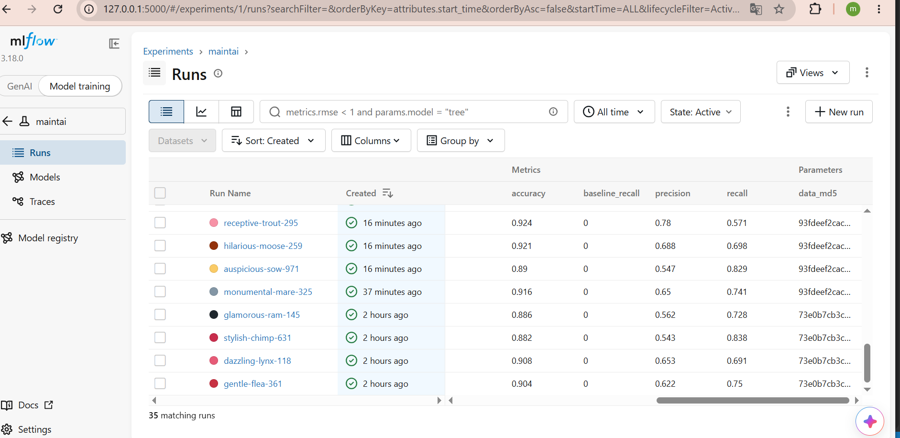
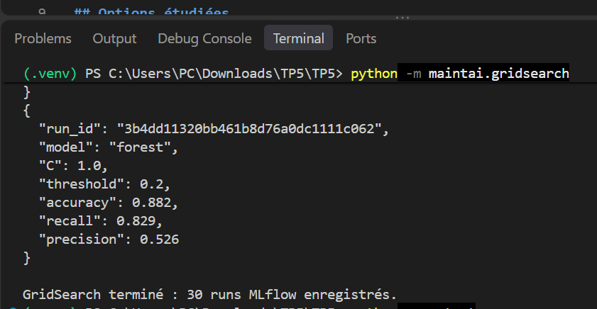

# Compte rendu · TP5 : suivre les entraînements (MLflow) et versionner les données (DVC)

**Groupe :** 9 · **Membres :** Malak Zaoufy · **Date :** 25/11/2026 18:06

> Les valeurs de ce compte rendu proviennent des résultats du terminal, des fichiers DVC et des runs MLflow réalisés pendant le TP5.

---

## 1. Mise en place (dans `TP/TP5`)

**Dernière ligne de `python -m pytest` après `pip install -r requirements.txt` et `pip install -e .` :**

```text
5 failed, 27 passed, 2 warnings
```

**Quels tests échouent, et pourquoi ?**

Les cinq tests qui échouent se trouvent dans `tests/test_tracking.py`. Ils vérifient les fonctionnalités de suivi des entraînements : la création du run, l'enregistrement des paramètres et des métriques, l'empreinte `data_md5`, le chargement du modèle et les options de sauvegarde du modèle.

Ces tests échouent initialement parce que la fonction `log_run` dans `maintai/tracking.py` n'est pas encore implémentée.

**Avant `pip install -e .`, où pointait le package `maintai` installé dans l'environnement ? Et après ?**

Avant l'installation éditable, le package `maintai` utilisé dans l'environnement provenait du TP4.

Après `pip install -e .`, le package pointe vers le code source du TP5 :

`C:\Users\PC\Downloads\TP5\TP5\maintai`

L'installation éditable permet de travailler directement sur le code source sans devoir réinstaller le package après chaque modification.

---

## 2. Sprint 1 : MLflow

**Votre fonction `log_run` (`maintai/tracking.py`) :**

```python
def log_run(params: dict, metrics: dict, model, X_example, data_path: Path) -> str:
    mlflow.set_experiment(EXPERIMENT)

    with mlflow.start_run() as run:
        mlflow.log_params(params)

        data_md5 = file_md5(data_path)
        mlflow.log_param("data_md5", data_md5)

        mlflow.log_metrics(metrics)

        mlflow.sklearn.log_model(
            model,
            name="model",
            input_example=X_example,
            skops_trusted_types=TRUSTED_TYPES,
        )

        run_id = run.info.run_id

    return run_id
```

**Dernière ligne de `python -m pytest` à la fin du sprint 1 :**

```text
32 passed
```

### Vos runs initiaux dans MLflow

| Commande | Recall | Precision | Accuracy |
|---|---:|---:|---:|
| `python -m maintai.train` | 0.750 | 0.622 | 0.904 |
| `python -m maintai.train --C 0.01` | 0.691 | 0.653 | 0.908 |
| `python -m maintai.train --threshold 0.2` | 0.838 | 0.543 | 0.882 |
| `python -m maintai.train --model forest` | 0.728 | 0.562 | 0.886 |

**Quel run choisiriez-vous pour MaintAI, et pourquoi ?**

Le choix dépend de la contrainte métier : une panne manquée coûte plus cher qu'une fausse alerte. Il faut donc privilégier le recall, qui mesure la proportion de pannes réelles détectées.

Parmi les quatre entraînements initiaux, le run avec `threshold=0.2` présente le meilleur recall (0.838). Il permet de détecter davantage de pannes, mais sa précision est plus faible (0.543), ce qui signifie qu'il génère davantage de fausses alertes.

### Extension demandée par le professeur : GridSearch

Un GridSearch a été ajouté afin de tester automatiquement 30 configurations et de comparer leurs performances.

**Grille utilisée :**

| Paramètre | Valeurs testées |
|---|---|
| Modèle | `logreg`, `forest` |
| C | `0.01`, `0.1`, `1.0` |
| Threshold | `0.2`, `0.3`, `0.4`, `0.5`, `0.6` |

Nombre de configurations :

`2 × 3 × 5 = 30 runs MLflow`

**Top 5 des configurations obtenues :**

| Modèle | C | Threshold | Recall | Precision | Accuracy |
|---|---:|---:|---:|---:|---:|
| logreg | 0.01 | 0.2 | 0.829 | 0.547 | 0.890 |
| logreg | 0.1 | 0.2 | 0.829 | 0.559 | 0.894 |
| forest | 0.01 | 0.2 | 0.829 | 0.526 | 0.882 |
| forest | 0.1 | 0.2 | 0.829 | 0.526 | 0.882 |
| forest | 1.0 | 0.2 | 0.829 | 0.526 | 0.882 |

**Configuration candidate retenue :**

- Modèle : `logreg`
- C : `0.1`
- Threshold : `0.2`
- Recall : `0.829`
- Precision : `0.559`
- Accuracy : `0.894`
- Run ID : `e94f929e8350460b8a5426eebfbf7b1a`

Cette configuration présente le meilleur compromis parmi les cinq premières configurations : elle possède le recall maximal et les meilleures valeurs de précision et d'accuracy dans ce classement.

Remarque : dans notre implémentation, le paramètre C est utilisé uniquement par la régression logistique. Les différentes valeurs de C pour Random Forest ne modifient donc pas son comportement. Ces runs sont redondants pour un même seuil.

**Dans `mlflow ui`, ouvrez le modèle d'un run. Quelle version de scikit-learn est indiquée dans son `requirements.txt` ? Quel problème du TP4 cela règle-t-il ?**

La version de scikit-learn indiquée dans le `requirements.txt` du modèle est **1.8.0**.

MLflow conserve les versions exactes des bibliothèques utilisées lors de l'entraînement. Cela facilite la reproduction de l'environnement et évite les incompatibilités entre les versions de scikit-learn utilisées pour entraîner et pour charger le modèle.

**Où MLflow enregistre-t-il les runs sur votre disque ? Ces fichiers vont-ils dans Git ? Pourquoi ?**

MLflow utilise principalement :

- `mlflow.db` pour enregistrer les métadonnées des runs.
- `mlruns/` pour stocker les artefacts associés aux entraînements et aux modèles.

Ces fichiers ne doivent pas être ajoutés à Git. Ils sont gérés par MLflow, peuvent être volumineux et ne font pas partie du code source à versionner dans Git.

---

## 3. Sprint 2 : DVC

**Contenu de `data/sensors.csv.dvc` après le premier `dvc add data/sensors.csv` :**

```yaml
outs:
- md5: 73e0b7cb3c6f795c70c3ddf970b99c15
  size: [taille à vérifier dans le fichier .dvc de la v1]
  hash: md5
  path: sensors.csv
```

**Comparez la valeur `md5` de ce fichier au paramètre `data_md5` de votre dernier run MLflow. Que constatez-vous ?**

L'empreinte MD5 du dataset v1 dans DVC est :

`73e0b7cb3c6f795c70c3ddf970b99c15`

Le run MLflow `gentle-flea-361` possède la même valeur dans son paramètre `data_md5`.

Les deux empreintes identiques prouvent que ce run a utilisé exactement la version v1 du dataset suivie par DVC.

Pour la v2, l'empreinte MD5 est :

`93fdeef2cac1893c4f720c16457eea75`

**Pourquoi `data/sensors.csv` ne va pas dans Git, alors que `data/sensors.csv.dvc` y va ?**

Le fichier `data/sensors.csv` contient les données elles-mêmes. Il peut être volumineux et Git n'est pas adapté au stockage de plusieurs versions de datasets.

Le fichier `data/sensors.csv.dvc` est un petit fichier de suivi qui contient notamment l'empreinte MD5, la taille et le chemin du dataset. Il permet à Git de versionner la référence vers les données conservées par DVC.

**Après `python -m maintai.dataset --n 8000 --seed 7`, que dit `dvc status` ?**

```text
changed outs:
    modified: data/sensors.csv
```

Cela signifie que le fichier a été modifié par rapport à la version précédemment suivie par DVC.

### Versions des données

| Version | Commit Git | MD5 (8 premiers caractères) | Nombre de lignes de données |
|---|---|---|---:|
| v1 | `0313e4e` — Données v1 | `73e0b7cb` | 5000 |
| v2 | `dd55a4b` — Données v2 | `93fdeef2` | 8000 |

Commit d'initialisation DVC : `9da9aa7`.

**Revenez à la v1 (`git checkout <commit> -- data/sensors.csv.dvc`, puis `dvc checkout`). Combien de lignes contient `data/sensors.csv` ? Puis revenez à la v2.**

Après restauration de la référence v1 avec `dvc checkout`, le fichier contient 5000 lignes de données.

Ensuite, après restauration de la référence v2 et exécution de `dvc checkout`, le fichier contient 8000 lignes de données.

**Supprimez `data/sensors.csv` et le dossier `.dvc/cache`, puis lancez `dvc pull`. Que se passe-t-il ?**

Le stockage distant local a été configuré dans :

`C:\Users\PC\dvc-stockage`

Après suppression du dataset et du cache local, la commande `dvc pull` récupère le fichier depuis ce stockage.

Résultat obtenu :

```text
1 file fetched and 1 file added
```

La vérification confirme que le dataset v2 contenant 8000 lignes a bien été restauré.

---

## 4. Relier modèle et données

**Entraînez un modèle sur la v2. Dans `mlflow ui`, comparez ce run à celui de la v1 avec les mêmes réglages :**

| Run | data_md5 (8 caractères) | n_train | Recall | Precision |
|---|---|---:|---:|---:|
| v1 — `gentle-flea-361` | `73e0b7cb` | 4000 | 0.750 | 0.622 |
| v2 — Run ID `f73553f91f71484f8092d26f7b43d101` | `93fdeef2` | 6400 | 0.741 | 0.650 |

Le run v2 utilise les réglages par défaut :

- Modèle : `logreg`
- C : `1.0`
- Threshold : `0.3`

**Peut-on dire que le modèle v2 est « meilleur » ? Pourquoi faut-il être prudent en comparant deux runs entraînés sur des données différentes ?**

Non, on ne peut pas conclure automatiquement que le modèle v2 est meilleur.

Le recall diminue de 0.750 pour la v1 à 0.741 pour la v2, tandis que la précision augmente de 0.622 à 0.650.

Les deux modèles ont été entraînés sur des datasets de tailles différentes, avec des distributions et des partitions d'évaluation potentiellement différentes.

Pour comparer rigoureusement les modèles, il faudrait les évaluer sur un même jeu de données indépendant et conserver les mêmes conditions d'évaluation.

---

## 5. Décision : l'ADR 004

La configuration candidate retenue à partir du GridSearch est la régression logistique avec les paramètres suivants :

- Modèle : `logreg`
- C : `0.1`
- Seuil : `0.2`
- Recall : `0.829`
- Precision : `0.559`
- Accuracy : `0.894`
- Run MLflow : `e94f929e8350460b8a5426eebfbf7b1a`
- Data MD5 : `93fdeef2cac1893c4f720c16457eea75`

Cette décision privilégie la détection des pannes, car une panne manquée coûte plus cher qu'une fausse alerte. Le seuil bas permet d'augmenter le recall, mais implique d'accepter davantage de fausses alertes.

L'identifiant du run et le MD5 permettent de retrouver précisément l'entraînement et les données utilisées.

---

## 6. Questions de compréhension

**1. Quelle différence entre Git, DVC et MLflow ? Que versionne chacun ?**

- **Git** versionne le code source, les fichiers de configuration et les fichiers de suivi DVC.
- **DVC** versionne les fichiers de données volumineux et permet de retrouver les différentes versions des datasets.
- **MLflow** conserve les runs d'entraînement, leurs paramètres, leurs métriques, les artefacts des modèles et les versions des bibliothèques utilisées.

**2. Pourquoi le stockage DVC est-il ajouté avec `--local` dans ce TP ? Que faudrait-il pour que tout le groupe partage les mêmes données ?**

L'option `--local` enregistre la configuration du stockage dans `.dvc/config.local`, un fichier ignoré par Git. Cela évite de partager un chemin local propre à un seul ordinateur.

Pour que tout le groupe partage les mêmes données, il faudrait configurer un stockage distant commun, accessible à tous les membres, par exemple un espace S3 ou un serveur partagé, puis configurer DVC sur chaque poste pour utiliser ce stockage.

**3. Livrer un modèle, c'est trois choses (TP4). Lesquelles, et où sont-elles maintenant ?**

Il faut livrer :

1. **Le code** : dans Git.
2. **Les données** : dans DVC, avec le fichier `.dvc` dans Git et les données dans le stockage DVC.
3. **Le modèle entraîné** : dans MLflow, avec son identifiant de run et ses artefacts.

Les versions exactes des bibliothèques utilisées sont également conservées dans le `requirements.txt` associé au modèle MLflow.

---

## 7. Le rendu Git

- Lien de la pull request : [À compléter avec l'URL GitHub de la PR]
- Le tag `tp5` existe sur GitHub : [À vérifier]
- `git status` avant le commit : [À vérifier que `mlflow.db`, `mlruns/`, `data/sensors.csv`, `.dvc/cache` et `.dvc/config.local` sont exclus du suivi Git.]

Ces fichiers doivent être exclus de Git grâce au `.gitignore`. Les données sont gérées par DVC et les informations d'entraînement par MLflow.

---

## 8. Ce qui reste flou


