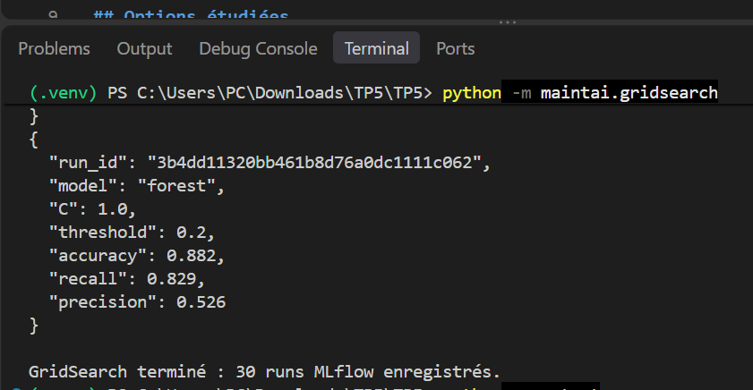
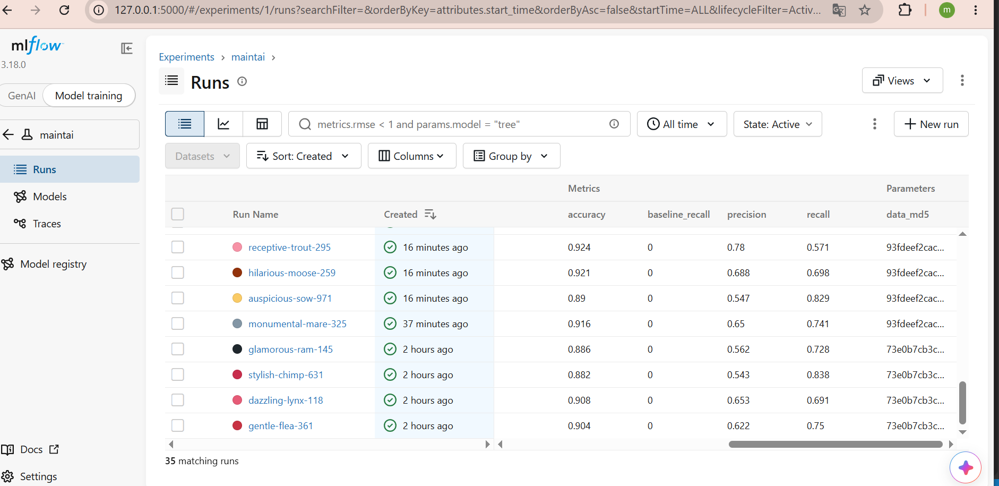

# ADR 004 : Choix du modèle de détection des pannes

Date : 25/11/2026 Heure: 17:55 · Auteurs : Zaoufy Malak

## Contexte

MaintAI doit détecter les pannes des machines à partir des données des capteurs. Une panne manquée peut avoir des conséquences plus graves qu'une fausse alerte. Il est donc important de privilégier un modèle ayant un bon recall, tout en conservant une précision acceptable.

## Options étudiées

1. **Régression logistique (Logistic Regression)** : modèle simple et rapide à entraîner. Ses performances dépendent notamment du paramètre de régularisation C et du seuil de décision.
2. **Forêt aléatoire (Random Forest)** : modèle capable de capturer des relations plus complexes, mais dont les performances doivent être comparées expérimentalement.

Un GridSearch de 30 configurations a été réalisé en testant deux modèles, trois valeurs de C et cinq seuils de décision.

## Décision

Nous retenons comme meilleur candidat la régression logistique avec les paramètres suivants :

- Modèle : `logreg`
- C : `0.1`
- Seuil : `0.2`
- Recall : `0.829`
- Precision : `0.559`
- Accuracy : `0.894`

Cette configuration présente le meilleur compromis parmi les configurations ayant obtenu le recall maximal. Le seuil de 0.2 favorise la détection des pannes, conformément à la contrainte métier.

Run MLflow : `e94f929e8350460b8a5426eebfbf7b1a`

Data MD5 : `93fdeef2cac1893c4f720c16457eea75`

## Conséquences

Cette décision permet de détecter davantage de pannes, mais implique d'accepter davantage de fausses alertes en raison du seuil de décision bas.

Les performances devront être surveillées sur de nouvelles données afin de vérifier que le modèle conserve un recall satisfaisant.

